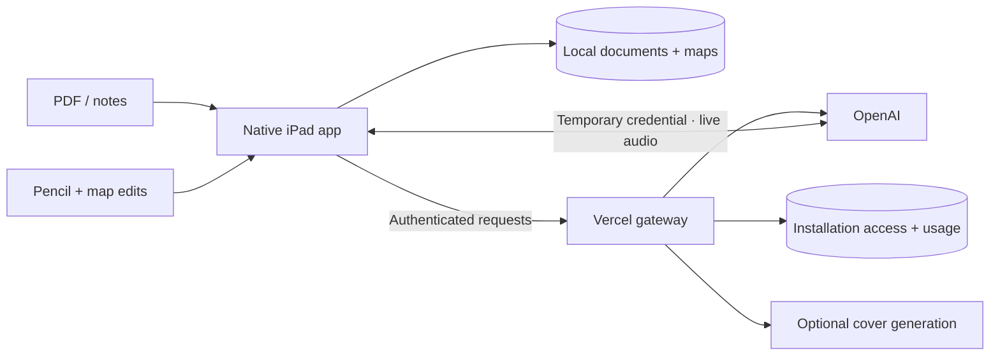

<div align="center">
  
  <h1>ReMap</h1>
  <p><strong>Turn what you read into a map you can explain.</strong></p>
  <p>A native iPad study canvas with Pencil input, PDF context and a conversational coach.</p>
  <p><strong>iPadOS 17+</strong> · SwiftUI · PencilKit · OpenAI Realtime</p>
  <p><a href="#the-learning-flow">Explore</a> · <a href="#run-the-app">Run locally</a> · <a href="docs/ARCHITECTURE.md">Architecture</a> · <a href="backend/README.md">Backend</a></p>
</div>

---

Reading gives you information. Explaining the connections shows what you understand.
ReMap brings those activities onto a paper-inspired canvas: collect ideas from a PDF,
organize them, connect them and talk through your reasoning.

## The learning flow

| Step | What you do |
| :--- | :--- |
| **Collect** | Import a PDF, paste notes or start with the included demo. |
| **Sort** | Separate backbone ideas, supporting topics and details. |
| **Build** | Place ideas and connect them on a zoomable canvas. |
| **Reflect** | Explain relationships through text or live voice. |
| **Revisit** | Reopen saved maps, refine connections and keep learning. |

### Made for the iPad

- **A tactile canvas.** Move ideas, draw with Pencil and keep sketches alongside the map.
- **A coach in context.** Conversations use the current map and available source material; PDF references open the relevant page.
- **Text and voice.** Ask a question, explain a connection or request a map edit. Voice includes live captions.
- **Edits you control.** Explicit coach commands are checked against the current map and applied as one undoable transaction.
- **Local persistence.** Maps, source documents and sketches stay on the device. Cloud coaching can be disabled.
- **Paper, ink and motion.** Warm textures and graphite illustrations support the learning flow.

## Run the app

The current toolchain is **Xcode 27**, Swift 6 and
[XcodeGen](https://github.com/yonaskolb/XcodeGen). The deployment target is
**iPadOS 17.0**; the SDK version does not change that requirement.

```sh
git clone https://github.com/ShadowBoxer228/remap.git
cd remap
xcodegen generate
open ReMap.xcodeproj
```

Select the **ReMap** scheme and an iPad simulator. For a physical device, choose
your own signing team in Xcode. `project.yml` defines the project; generated Xcode
projects and personal signing state are excluded from Git.

Build without installing:

```sh
xcodebuild -project ReMap.xcodeproj -scheme ReMap -destination 'generic/platform=iOS Simulator' -derivedDataPath build/LocalDerivedData build
```

The local canvas does not require a provider key. Cloud features require an
authorized gateway connection. TestFlight access is managed separately; cloning
this repository does not grant access to the hosted service. To run your own
gateway, follow [backend/README.md](backend/README.md).

## How it fits together



Provider credentials stay on the server. The app stores installation access in
Keychain and uses temporary credentials for live voice. The gateway owns model
configuration; the app validates map mutations again before applying them. Read the
[architecture notes](docs/ARCHITECTURE.md) and [privacy boundaries](docs/PRIVACY.md).

## Repository guide

| Path | Contents |
| :--- | :--- |
| [`ReMap/`](ReMap/) | Native application, canvas, coach, source handling and persistence |
| [`ReMapTests/`](ReMapTests/) | Model, command, lifecycle and audio tests |
| [`backend/`](backend/) | Authenticated Hono gateway and protocol tests |
| [`art/`](art/README.md) | Illustration sources, prompts and visual identity |
| [`Licenses/`](Licenses/) | Third-party font license |
| [`tools/`](tools/) | Asset preparation and development helpers |
| [`project.yml`](project.yml) | XcodeGen project definition |

## Snapshot

This repository currently contains the completed **1.0.0 (4)** app source and matching gateway snapshot. Further coaching refinements are in development and will be published after qualification.

## Verification and platform support

Backend checks run with `npm ci` and `npm test` from `backend/`. Native tests run
with the ReMap scheme on an explicitly selected iPad simulator; see
[CONTRIBUTING.md](CONTRIBUTING.md).

**iPadOS 17 is the primary target.** Newer APIs have compatibility paths; Foundation
Models is optional. A build targeting 17 or a run on a newer simulator is not an
actual iPadOS 17 runtime check. Physical Pencil, acoustic behavior and fresh
TestFlight enrollment need their own device evidence. See [IOS17.md](IOS17.md).

## Contributing and security

Start with [CONTRIBUTING.md](CONTRIBUTING.md). For security reports and credential
handling, read [SECURITY.md](SECURITY.md). Keep private documents, recordings, tokens
and device identifiers out of public issues.

Shantell Sans is distributed under the [SIL Open Font License](Licenses/OFL-ShantellSans.txt).
Artwork provenance is documented in [art/README.md](art/README.md). Public source
visibility does not itself grant a license to the rest of the project; no general
open-source license is currently specified.
