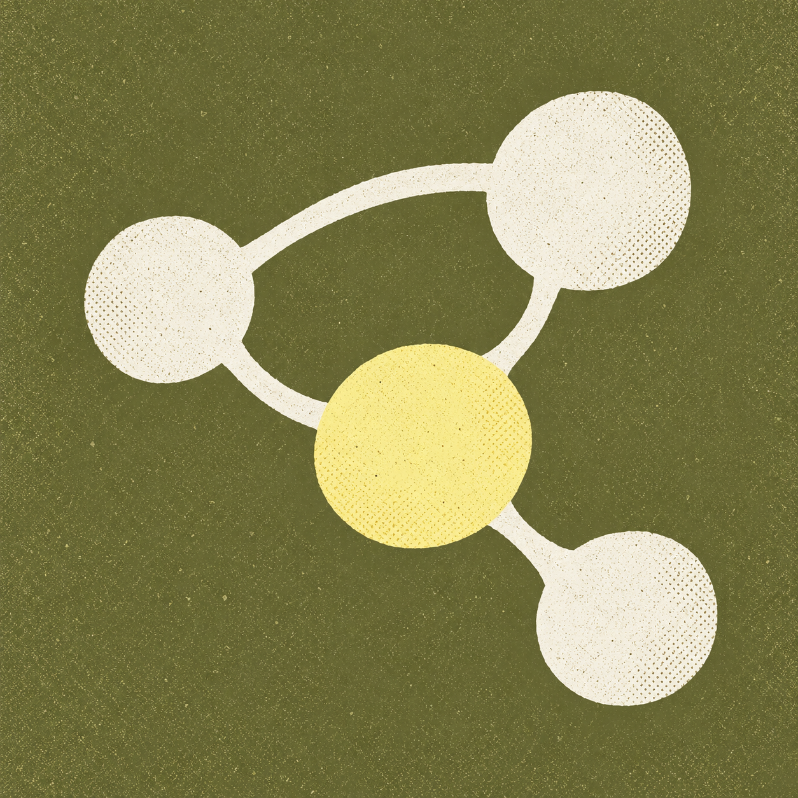

# Connected ideas

The icon is a compact paper mind map: cream nodes, a butter-yellow focal idea and
an olive paper background. The wordmark is rendered natively in SwiftUI.

- [Master image](remap-connected-ideas.png)
- [Generation prompt](remap-connected-ideas.prompt.md)
- [Native wordmark](WORDMARK.md)
- [App asset](../../ReMap/Resources/Assets.xcassets/AppIcon.appiconset/AppIcon.png)

From the root, `swift tools/make_icon.swift` exports a 1024 × 1024 opaque sRGB icon.
Keep square corners; the OS provides the mask. Earlier concepts are preserved
in [archive](../archive/).
